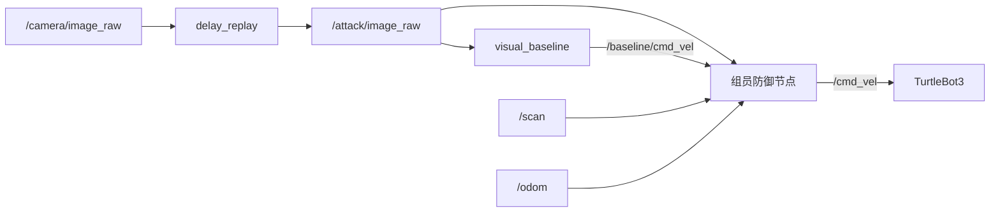

# 延迟重放复现与防御接入

本指南用于在另一台 Ubuntu 机器上复现房子、道路、白线和红方块场景，并把组员的防御节点接入现有链路。工作分支为 `delayed-frame-replay`，仓库目录以下统一使用 `~/tb3-delay-replay`。

## 环境与一次性准备

已使用的环境为 Ubuntu 24.04.4 LTS、ROS 2 Jazzy、Gazebo Harmonic（Gazebo Sim 8.15.0）、TurtleBot3 Waffle Pi；原 VMware 分配 4 个 CPU、8 GiB 内存。软件渲染由场景脚本默认启用。

先安装 ROS 2 Jazzy Desktop，确保 `/opt/ros/jazzy/setup.bash` 存在。安装入口见 [ROS 官方 Ubuntu 安装指南](https://docs.ros.org/en/jazzy/Installation/Ubuntu-Install-Debs.html)；机器人与仿真环境可参考 [ROBOTIS Jazzy PC Setup](https://emanual.robotis.com/docs/en/platform/turtlebot3/quick-start/) 和 [仿真说明](https://emanual.robotis.com/docs/en/platform/turtlebot3/simulation/)，页面中选择 Jazzy。

在已配置 ROS 软件源的 Ubuntu 终端安装构建和运行依赖：

```bash
sudo apt update
sudo apt install -y git python3-colcon-common-extensions python3-vcstool \
  python3-rosdep python3-opencv python3-numpy ros-jazzy-cv-bridge \
  ros-jazzy-ros-gz ros-jazzy-dynamixel-sdk
source /opt/ros/jazzy/setup.bash
```

下载工作分支到 Ubuntu 本地文件系统，不在 VMware 共享挂载目录内构建：

```bash
git clone --branch delayed-frame-replay \
  https://github.com/syzhang03/turtlebot3-visual-input-attack-verification.git \
  ~/tb3-delay-replay
```

如果尚未初始化 rosdep，执行一次 `sudo rosdep init`；已初始化的机器跳过。随后运行 `rosdep update`。

如果已经有可启动 Waffle Pi 的 `~/turtlebot3_ws`，核对其中三个仓库与 [依赖版本文件](../configs/turtlebot3.repos) 一致后跳到项目构建；不要在已有工作区里重复克隆或覆盖组员修改。新机器建立依赖工作区：

```bash
mkdir -p ~/turtlebot3_ws/src
vcs import ~/turtlebot3_ws/src < ~/tb3-delay-replay/configs/turtlebot3.repos
cd ~/turtlebot3_ws
source /opt/ros/jazzy/setup.bash
rosdep install --from-paths src --ignore-src --rosdistro jazzy -r -y
colcon build --symlink-install --parallel-workers 2
```

构建本项目并运行测试：

```bash
cd ~/tb3-delay-replay
source /opt/ros/jazzy/setup.bash
source ~/turtlebot3_ws/install/setup.bash
rosdep install --from-paths src --ignore-src --rosdistro jazzy -r -y
bash scripts/build_baseline.sh
PYTHONPATH="$PWD/src/tb3_visual_baseline" python3 -m unittest discover -s src/tb3_visual_baseline/test -v
source install/setup.bash
ros2 pkg prefix turtlebot3_gazebo
ros2 pkg executables tb3_visual_baseline
```

最后应能找到 `turtlebot3_gazebo`，并看到 `baseline` 和 `delay_replay` 两个可执行程序。辅助脚本默认依赖 `~/turtlebot3_ws`；若目录不同，各终端设置 `TB3_WS` 指向实际依赖工作区。

## 复现无防御的三组试验

固定配置为 [baseline_white_line.yaml](../configs/baseline_white_line.yaml)：速度 1.0 m/s、红色阈值 0.4、关闭终点停车、传感器超时 2.0 墙钟秒。白线是停车位置参照，控制器根据红色障碍比例停车，不识别白线。

每次先结束旧控制器、中继和场景，关闭 teleop 和额外图像查看器，使各组负载尽量一致。三个终端保持相同的 `ROS_DOMAIN_ID=33`；不同机器同时开展独立实验时，应使用各自独立的域，避免互相接收传感器或速度话题。

终端 A，启动场景并等待 `SCENE_READY`：

```bash
cd ~/tb3-delay-replay
ROS_DOMAIN_ID=33 bash scripts/start_scene.sh
```

终端 B，先做 0 秒中继对照：

```bash
cd ~/tb3-delay-replay
ROS_DOMAIN_ID=33 bash scripts/run_relay.sh 0.0
```

等待 `ZERO_DELAY` 后，终端 C 启动控制器：

```bash
cd ~/tb3-delay-replay
ROS_DOMAIN_ID=33 bash scripts/run_relay_baseline.sh
```

操作者已观察到无延迟时停在白线处。保存这轮结果后依次 Ctrl+C 停止 C、B、A，重新启动 A，把 B 的参数改成 `0.5`，等待 `REPLAY` 再启动 C。随后用同样流程运行 `1.0` 秒组。已观察到的现象分别是 0.5 秒组越过白线后停车、1 秒组撞上方块后停车；不同机器的帧率和传输时序会影响具体停车位置。

每轮都检查控制器启动行：

```text
Control: speed=1.0; red_threshold=0.4; goal_stop=False; sensor_timeout=2.0
```

`run_relay.sh` 的窗口为 600 仿真秒，从收到第一张图像开始计时。等待太久时重启中继；缓冲未就绪时会实时转发并标为 `BUFFER_NOT_READY`。终端出现 `REPLAY; elapsed=...` 中的 elapsed 是中继运行时间，不是实际延迟；实际延迟看 `frames.csv`。

只想排查原相机时，可在重置场景后用 `bash scripts/run_baseline.sh drive` 直连 `/camera/image_raw`。正式延迟比较用同一中继的 0 秒组作对照。

## 防御节点接入

当前视觉基线将检测与控制放在同一节点，最少改动的接法是在其速度输出之后加入组员实现的防御节点：



| 话题 | 消息类型 | 用途与 QoS |
|---|---|---|
| `/attack/image_raw` | `sensor_msgs/msg/Image` | 防御使用的受攻击视觉输入；reliable、keep-last 深度 1 |
| `/scan` | `sensor_msgs/msg/LaserScan` | 本攻击未修改的 LiDAR 输入；订阅采用 SensorData QoS，并用 topic info 核对发布端 |
| `/odom` | `nav_msgs/msg/Odometry` | 运动状态参考；SensorData QoS |
| `/baseline/cmd_vel` | `geometry_msgs/msg/TwistStamped` | 视觉控制器提出的速度；默认可靠发布、深度 10 |
| `/cmd_vel` | `geometry_msgs/msg/TwistStamped` | 防御判断后的最终机器人指令，只保留一个发布者 |

防御算法与可执行节点需要组员实现，本仓库尚无可直接运行的防御程序。中继仅修改图像内容，不修改 `/scan` 和 `/odom`。

组员实现防御节点后，终端 A、B 的场景与攻击启动方式不变。先启动防御节点，再用下面的命令替代终端 C 的 `run_relay_baseline.sh`，把视觉指令送到防御输入：

```bash
cd ~/tb3-delay-replay
source /opt/ros/jazzy/setup.bash
source ~/turtlebot3_ws/install/setup.bash
source install/setup.bash
export ROS_DOMAIN_ID=33
ros2 run tb3_visual_baseline baseline --ros-args \
  --params-file "$PWD/configs/baseline_white_line.yaml" \
  -p image_topic:=/attack/image_raw \
  -p image_reliability:=reliable \
  -p cmd_topic:=/baseline/cmd_vel \
  -p enabled:=true
```

防御节点使用同一域并设置 `use_sim_time=true`，订阅 `/baseline/cmd_vel`，将允许执行的指令或停止指令发布到 `/cmd_vel`。不要同时运行原先直接发布 `/cmd_vel` 的基线启动命令。连接后检查：

```bash
ros2 topic info /attack/image_raw --verbose
ros2 topic info /scan --verbose
ros2 topic info /baseline/cmd_vel --verbose
ros2 topic info /cmd_vel --verbose
```

`/cmd_vel` 应只有防御节点一个发布者。图像中继使用当前输入的 header 配合历史图像内容，因此“消息刚收到”或“header 时间戳很新”不能证明视觉内容是当前的；这是跨传感器防御需要处理的情况。

## 保存结果与比较

- 中继日志：`~/replay-results/<run-id>/config.json`、`frames.csv`。
- 控制器日志：`~/baseline-results/<run-id>/config.json`、`events.csv`。
- 每轮记录：代码提交号、延迟设置、实际延迟、是否越过白线、是否接触、是否完全停住、控制器与中继两个 run ID；截图对应同一轮。
- 接入防御后，控制器 CSV 的 `cmd_v` 是防御前的建议指令。还应记录最终 `/cmd_vel` 和防御告警/干预时刻，不能用前者代替最终执行指令。
- 保留全部结果；先在当前版本重做无防御的 0、0.5、1 秒组，再与相同配置下的防御组比较。旧版有终点停车的试次单独保留。

运行出现 `SENSOR_TIMEOUT` 时，先停止试验，再用 `ROS_DOMAIN_ID=33 bash scripts/check_camera_streams.sh` 检查两路图像，勿把超时停车归因于攻击检测或防御成功。

已归档结果及离线复核方法见 [实验记录](../results/delay-replay-2026-10-30/README.md)；中继实现细节见 [延迟重放说明](delay-replay.md)。
